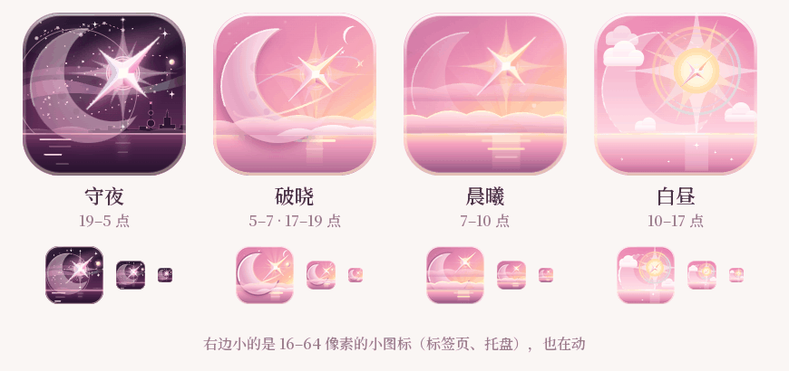

# Alaxee 曦 · 品牌与界面套件

图标、logo、字体、颜色、界面模板放在一个文件夹里，彼此配套，可以整个拿去别的项目用。
来源：ALAXEE V11（月牙守夜，晨星破晓），加上远黛的粉色、质感和动效打磨。

**先打开 `index.html` 看一遍**：现在是哪个时段、四个时段的图标、状态、logo、颜色和字、界面样例，以及怎么用。全部组件在 `ui/index.html`。



## 里面有什么

```
alaxee-kit/
├─ index.html               总览（先看这个）
├─ brand/
│  ├─ icons/
│  │  ├─ animated/           会动的图标 SVG（网页里用，放多大都不糊）
│  │  ├─ static/             静止的图标 SVG（印刷、设计稿、不想要动效的地方）
│  │  ├─ png/                PNG：完整版 64–1024 像素，小图标版 16–48 像素
│  │  └─ ico/                Windows 多尺寸 .ico（32 像素及以下自动用小图标）
│  ├─ logo/                  横版 / 竖版 / 只有字 × 浅色底 / 深色底 × 静止 SVG、PNG、会动的 SVG
│  ├─ web/                   网页和 PWA：favicon、apple-touch-icon、192 / 512 / 可遮罩图标、manifest、head.html
│  ├─ tray/                  桌面托盘：每个时段一张静止图，想事情时 12 帧呼吸，睡着时一张
│  ├─ xi/                    小曦（吉祥物）：白天 / 晚上
│  ├─ preview/               动效预览 GIF（发给别人看）
│  └─ HISTORY.md             图标每一版改了什么、为什么
├─ ui/                       界面模板：alaxee-ui.css、alaxee-ui.js、组件页 index.html、组件说明 README.md
├─ tokens/                   设计变量：tokens.css（只有变量）、tokens.json、tailwind.preset.js
├─ fonts/                    思源宋体（Noto Serif SC）woff2 + fonts.css，SIL OFL，可以商用
└─ tools/make_logo.py        换成你的名字，生成整套 logo
```

## 图标

### 一天四时

| 时段 | 文件名里的词 | 时间 | 画面 |
|---|---|---|---|
| 守夜 | `night` | 19:00–5:00 | 夜里星最亮：月亮退后当背景，晨星是全天最大的那颗；极光、流星、远处的外滩 |
| 破晓 | `day` | 5:00–7:00，傍晚 17:00–19:00 也用它 | 晨星从云海后升起，曦光从玫瑰到蜜桃（主版，favicon 默认用它） |
| 晨曦 | `morning` | 7:00–10:00 | 太阳从云海升起，晨星还挂着，鸟飞过 |
| 白昼 | `noon` | 10:00–17:00 | 太阳就是那颗星：彩虹日晕、旋转的光冠、海面碎光 |

### 文件

下面的 `{时段}` 换成 `night`、`day`、`morning`、`noon` 之一。

| 文件 | 什么时候用 |
|---|---|
| `icon-{时段}.svg` | 完整版：应用图标、启动画面、关于页，64 像素以上 |
| `icon-{时段}-small.svg` | 小图标版：网页标签、托盘、列表，16–64 像素。不是简化成符号，而是同一幅画放大主角、加粗线条，也在动 |
| `icon-{时段}-think.svg` | “在想事情”：晨星、光晕、涟漪一起呼吸得更快（只有会动的版本） |
| `icon-night-sleep.svg`、`-small.svg` | “睡着了”：守夜里打盹的星（冒着 z），月亮守着它 |
| `icon-day-rise.svg` | 破晓开场：天从夜色亮起，晨星从云海后升起、闪一下，然后进入平常的呼吸。只放一次，用在启动画面、首屏、天亮时 |

规则：用户打开页面或程序时，按时间选时段；在想事情时换 `-think`；睡着了换 `night-sleep`；从守夜换到别的时段时（天亮了、或者睡醒了），先放一遍 `day-rise` 再接平常的图标。网页里 `alaxee-ui.js` 会自动做这些（见下面）。

动效全是 SVG 自带的动画（SMIL），放在 `` 里也会动，不需要脚本。系统打开“减少动态效果”时，换成 `static/` 里的同名文件。

## Logo

`brand/logo/` 里是“远黛 / YUANDAI”这一套：

| 文件 | 说明 |
|---|---|
| `logo-h-light.svg/.png`、`logo-h-dark.svg/.png` | 横版。light 放浅色底，dark 放深色底；PNG 是 2 倍大小、透明底 |
| `logo-v-*.svg/.png` | 竖版（图标在上） |
| `wordmark-*.svg/.png` | 只有字 |
| `logo-*-animated.svg` | 会动的版本：图标在呼吸（浅色版先放一遍破晓开场），名字一个字一个字浮现。适合网页、GitHub README |

字已经转成路径，用的地方不用装字体。GitHub README 里跟着系统深浅色换：

```html
<picture>
  <source media="(prefers-color-scheme: dark)" srcset="brand/logo/logo-h-dark-animated.svg">
  
</picture>
```

**换成别的名字**（需要 Python 和 `pip install fonttools brotli resvg-py pillow`）：

```bash
python tools/make_logo.py --name 星河 --sub XINGHE              # 写到 brand/logo/
python tools/make_logo.py --name Nova --sub "personal ai" --out ../my-logo
python tools/make_logo.py --name 星河                            # 只有一行字也行
```

中文和英文都可以（用的是 `fonts/` 里的思源宋体）。

## 网页图标（favicon、手机主屏幕）

把 `brand/web/` 里的文件放到网站根目录，再把 `brand/web/head.html` 里的几行贴进 `<head>`。记得把 `site.webmanifest` 里的 `name` 改成你的应用名。
想让网页标签的小图标也跟着时段变：给 `<link rel="icon">` 加上 `data-ax-icon`（见下面）。

## 界面

纯 CSS 加一个可选的小脚本，不依赖任何框架：React、Vue、Svelte、纯 HTML、Python 后端吐出来的页面都能用。组件说明见 `ui/README.md`，样子见 `ui/index.html`。

```html
<html lang="zh-CN" data-ax-theme="auto">                          <!-- auto | xi | dusk | glass | alaxee -->
<head>
  <link rel="stylesheet" href="alaxee-kit/fonts/fonts.css">         <!-- 宋体标题，可选；不引就用系统里的宋体 -->
  <link rel="stylesheet" href="alaxee-kit/ui/alaxee-ui.css">
  <link rel="icon" href="alaxee-kit/brand/icons/animated/icon-day-small.svg"
        data-ax-icon="alaxee-kit/brand/icons/animated/" data-ax-icon-size="small">
</head>
<body class="ax ax-root">
  
  <button class="ax-btn ax-btn--dawn">开始</button>
  <script src="alaxee-kit/ui/alaxee-ui.js"></script>
</body>
</html>
```

### 主题

| `data-ax-theme` | 样子 | 适合 |
|---|---|---|
| `xi` 曦·晨粉 | 暖白底、玫瑰粉 | 默认，白天 |
| `dusk` 暮·梅子 | 暖黑底、樱粉 | 晚上、深色模式 |
| `glass` 磨砂玻璃 | 深色半透明玻璃、象牙白按钮 | 盖在图片 / 3D 场景上；给 `.ax-root` 设 `--ax-backdrop: url(...)` |
| `alaxee` V11 夜空 | 深蓝紫、蓝紫→粉→金渐变 | 原版 ALAXEE 风格 |
| `auto` | 守夜时段（19–5 点）用 `dusk`，其余用 `xi` | 需要 `alaxee-ui.js`；和图标的时段一致 |

### 脚本 `alaxee-ui.js`（可选）

| 写法 | 作用 |
|---|---|
| `AX.theme('dusk')` / `AX.theme('auto')` | 换主题（会记住） |
| `` | 图标跟着时段和状态自动换；加 `data-ax-icon-size="small"` 用小图标版；加 `data-ax-icon-static="…/static/"`，减少动效时换静止版 |
| `AX.state('think')` / `'sleep'` / `''` | 状态：在想事情 / 睡着了 / 平常。图标跟着换；写了 `data-ax-follow` 的 `.ax-orb` 光球也跟着变 |
| `AX.period()` | 现在的时段：`'night'`、`'day'`、`'morning'`、`'noon'`（`<html>` 上也有 `data-ax-period`） |
| `AX.toast('已保存')`、`AX.open('#id')` | 提示条、弹窗 |

固定 `dusk` 主题时图标一直是守夜；固定 `xi` 时夜里用破晓。

### React / Vue / Tailwind

- **React / Vue**：在入口 `import "./alaxee-kit/ui/alaxee-ui.css"`（和 `fonts/fonts.css`），组件里直接写 `className="ax-btn ax-btn--dawn"`。`alaxee-ui.js` 在入口 `import` 一次（挂在 `window.AX` 上），不用也行。
- **Tailwind**：`tailwind.config.js` 里 `presets: [require("./alaxee-kit/tokens/tailwind.preset.js")]`，然后用 `bg-ax-surface text-ax-ink border-ax-line rounded-ax-lg bg-ax-dawn shadow-ax-md animate-ax-breathe`。颜色都指向 CSS 变量，所以还要引入 `tokens/tokens.css`（或整个 `alaxee-ui.css`），换主题时一起变。
- **别的平台**（小程序、Flutter、设计软件）：颜色、字号、圆角、动效都在 `tokens/tokens.json`。

## 桌面程序

- Windows 图标：`brand/icons/ico/icon-{时段}.ico`（快捷方式、任务栏）。
- 托盘：平常用 `brand/tray/{时段}.png`；在想事情时轮流显示 `brand/tray/{时段}-00.png` … `-11.png`（每帧约 0.135 秒，晨星一下一下地呼吸）；睡着时用 `brand/tray/night-sleep.png`。
- 时段规则和网页一样（守夜 19–5 点、破晓 5–7 和 17–19 点、晨曦 7–10 点、白昼 10–17 点）。

## 设计规范

- **主色**：玫瑰粉 `#D9659C`（深色底上用 `#F28DB8`）。曦光渐变：玫瑰 → 蜜桃 → 晨金（`--ax-grad-dawn`）。
- **文字**：浅色底 `#4A3340`（次要 `#9C7E8A`），深色底 `#F3EDE7`（次要 `#B5A9A4`）。
- **字体**：标题、logo、“她说的话”用思源宋体 Noto Serif SC（600 粗）；正文用系统字体（苹方、鸿蒙、微软雅黑）。
- **呼吸**：所有动效跟着晨星的呼吸——放大缩小 `.84 → 1.26`，一下 3.6 秒，缓入缓出 `cubic-bezier(.4, 0, .6, 1)`。守夜慢一点（5 秒），白昼 4 秒；在想事情时快到 0.45 倍。界面反馈 200 毫秒，换页 360 毫秒。
- **形状**：四角星（“曦”）是贯穿一切的符号——按钮点按迸出的小星星、勾选框里的勾、进度条末端、加载的转圈。圆角：图标 22.86%（和 iOS 一致），卡片 20 像素，按钮全圆。
- **减少动态效果**：系统打开时，界面动画全部停下，图标换静止版。

## 维护（在远黛仓库里）

- 改图标：`design/ui/build_icons.py`，然后跑 `design/ui/build_kit.py` 重新整理这个文件夹（`brand/` 的 SVG、logo、web、tray、xi，`fonts/`，`tokens/` 都是生成的，别手改）。
- `ui/` 里的 css、js、组件页是手写的，就在这里改；改了第 1 节的变量，重跑 `build_kit.py` 会更新 `tokens/`。
- `build_kit.py --zip 路径` 另外打一个压缩包。

## 授权

图标、logo 和界面设计属于 Alaxee。思源宋体 / Noto Serif SC 是 SIL OFL 授权（`fonts/OFL-NotoSerifSC.txt`），可以商用。
