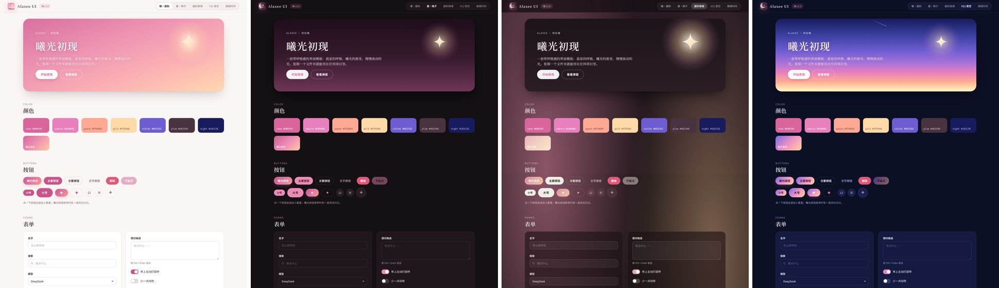

# Alaxee UI · 曦（v1.1）

一套带呼吸感的界面模板：晨星的呼吸、曦光的渐变、慢慢流动的光。
**不依赖任何框架**：纯 CSS 加一个可选的小脚本，React、Vue、Svelte、纯 HTML，或者 Python 后端吐出来的页面都能用。

来源：ALAXEE V11 规范（强呼吸 `scale .84→1.26 · 3.6s`、曦光渐变、四角星），加上远黛的粉色和质感打磨。



## 用到别的项目里

这个文件夹是整套 `alaxee-kit/` 的一部分：怎么引入、图标跟着时段换、React / Vue / Tailwind 的用法，都在上一层的 [README.md](../README.md)。这里只列组件。

## 主题

| `data-ax-theme` | 样子 | 适合 |
|---|---|---|
| `xi` 曦·晨粉 | 暖白底、玫瑰粉 | 默认，白天 |
| `dusk` 暮·梅子 | 暖黑底、樱粉 | 晚上、深色模式 |
| `glass` 磨砂玻璃 | 深色半透明玻璃、象牙白按钮 | 盖在图片 / 3D 场景上；给 `.ax-root` 设 `--ax-backdrop: url(...)` |
| `alaxee` V11 夜空 | 深蓝紫、蓝紫→粉→金渐变 | 原版 ALAXEE 风格 |
| `auto` | 守夜时段（19–5 点）`dusk`，其余 `xi` | 需要 `alaxee-ui.js` |

换主题：`AX.theme('dusk')`（会记住）；`AX.theme('auto')` 恢复跟随时间。
页面里的图标跟着时段和状态自动换：``，`AX.state('think' | 'sleep' | '')`（详见上一层 README）。

想改颜色，只要覆盖变量：

```css
[data-ax-theme="xi"] { --ax-accent: #B84A7E; --ax-grad-cta: linear-gradient(135deg, #B84A7E, #F29A8A); }
```

## 组件一览

| 类名 | 是什么 |
|---|---|
| `ax-btn` + `--dawn` `--light` `--secondary` `--ghost` `--danger` `--icon` `--sm` `--lg` `--block`，`is-loading` | 按钮。曦光按钮悬停有流光；点按迸出小星星；加载时星星在转 |
| `ax-input` `ax-textarea` `ax-select` `ax-field` `ax-label` `ax-help` `ax-error` `ax-input-group` | 输入框和表单排版 |
| `ax-switch` `ax-check` `ax-range` | 拨动开关、勾选（勾是一颗星）、滑块 |
| `ax-seg` `ax-tabs` | 分段选择、标签页（下划线是一道滑过去的光） |
| `ax-card` + `--hover` `--flat` `--glow`，`ax-panel` | 卡片（`--glow` 边框有一圈晨光在转）、磨砂面板 |
| `ax-list` `ax-chip` `ax-badge` `ax-dot` `ax-avatar` `ax-appicon` | 列表、小标签、数字徽标、状态点、头像、应用图标 |
| `ax-progress` + `--thin` `--indeterminate`，`ax-spinner` `ax-typing` `ax-skeleton` | 进度条（流光 + 末端一颗星）、加载、正在输入、骨架屏 |
| `ax-orb`（`data-state="idle / think / talk / listen / sleep"`），`ax-presence` | 呼吸光球：在想时变快、说话 / 听时有涟漪、睡着时变慢变暗 |
| `ax-chat` `ax-msg--her` `ax-msg--me` `ax-composer` | 对话：她的话用宋体不加气泡，你的话是浅色气泡；输入框跟着内容长高 |
| `ax-toast`（`AX.toast()`），`ax-modal`（`<dialog>`），`data-ax-tip` | 提示条、弹窗、悬停提示 |
| `ax-empty` | 空状态（小曦飘着） |
| `ax-sky` `ax-sky__stars` `ax-sky__star` `ax-meteor` | 曦光天空背景：星点闪烁、呼吸的晨星、流星 |
| `ax-breathe` `ax-twinkle` `ax-float` `ax-rise` `ax-rise-stagger` `ax-dawn-in` | 动效工具类 |
| `ax-stack` `ax-row` `ax-grid` `ax-spacer` `ax-divider` | 简单排版 |

## 动效

- 节奏统一用 V11 的“强呼吸”：`--ax-breath: 3.6s`、`cubic-bezier(.4, 0, .6, 1)`；界面反馈 200 ms，换页 360 ms，流光 3.4 s。
- 系统打开“减少动态效果”，或者 `<html data-ax-motion="reduce">` 时，所有动画都停下。
- 点按小星星不想要：给按钮加 `ax-btn--quiet`。

## 图标

图标、logo、小曦都在 `../brand/`，说明见上一层的 [README.md](../README.md)。

## 授权

图标和界面设计属于 Alaxee。思源宋体 / Noto Serif SC 是 SIL OFL 授权，可以商用。
